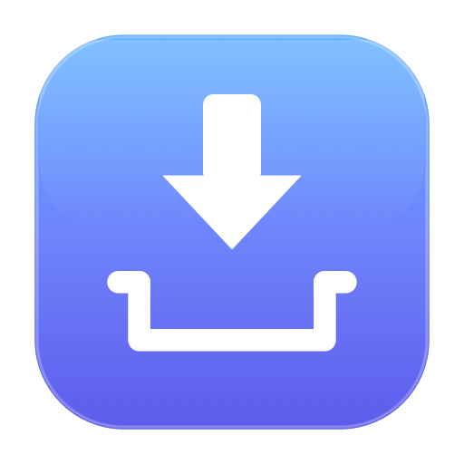
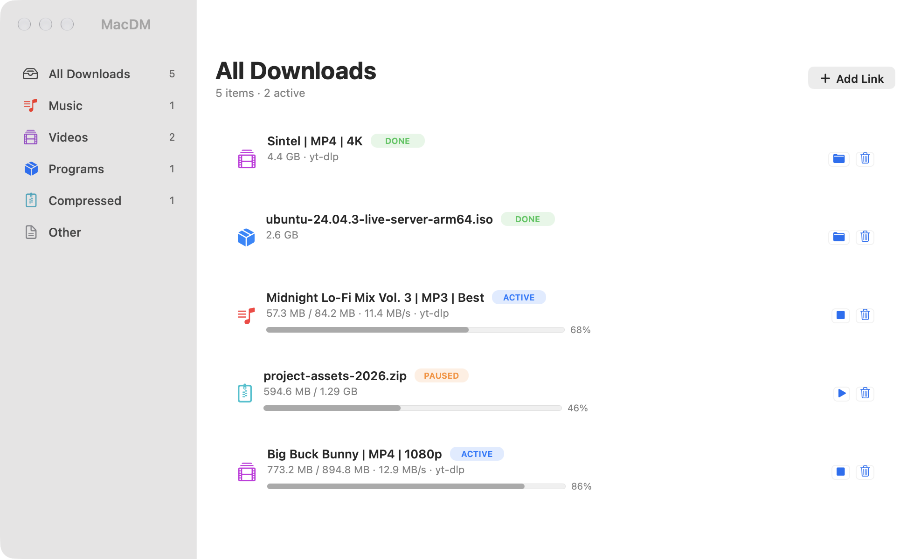
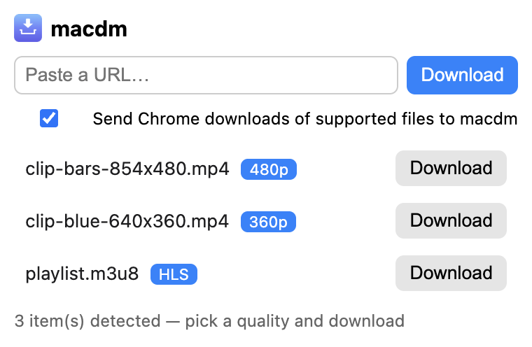
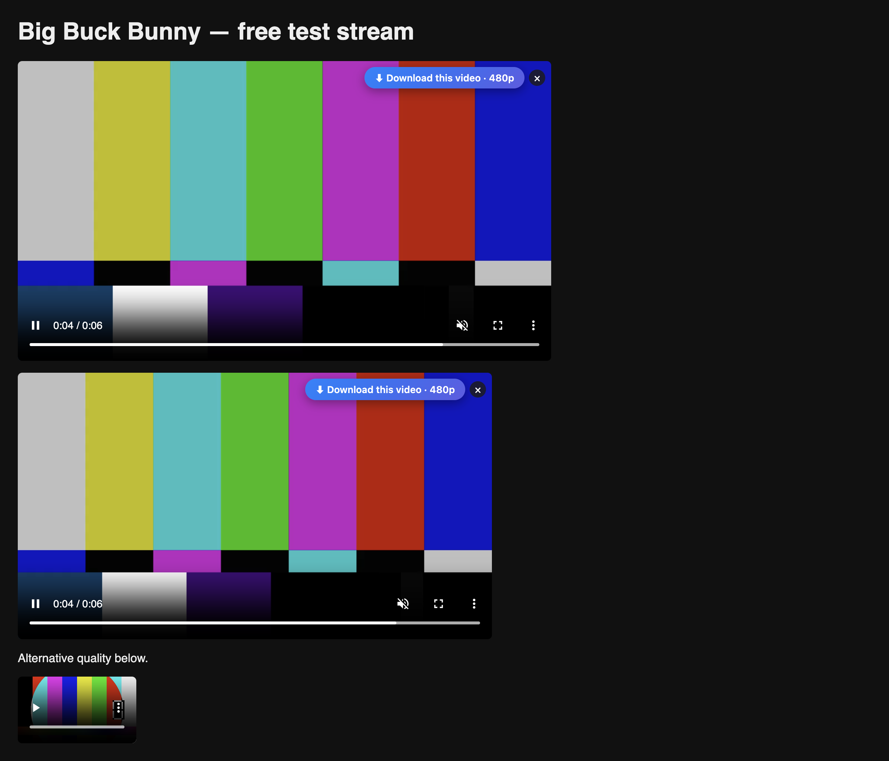

<div align="center">



# MacDM

**A native macOS download manager with an IDM-style Chrome extension — grab videos straight off the page.**

[](#requirements)
[](#build--install)
[](#chrome-extension)
[](#requirements)
[](LICENSE)

*Parallel segmented downloads · 1000+ video sites via yt-dlp · HLS/DASH capture · everything lands as .mp4*

</div>

---

## Screenshots

| Downloads window | Chrome extension popup |
| --- | --- |
|  |  |

<div align="center">

**IDM-style overlay** — a *Download this video* button appears directly on every player on any web page.



</div>

## Why MacDM

Browser downloads are one-speed-at-a-time, they land wherever Chrome decides, and saving a video from a streaming page is usually impossible. MacDM fixes all three:

- **Parallel by default** — files are split into 6 segments and downloaded concurrently, with automatic resume from the exact byte a failed transfer died at.
- **Videos from any page** — the Chrome extension detects players, playlists (HLS/DASH), and 1000+ video sites (YouTube, Vimeo, X, TikTok, Rumble, Bilibili…) via [yt-dlp](https://github.com/yt-dlp/yt-dlp), then hands them to the app.
- **Everything lands as `.mp4`** — merged video+audio and stream-copy remux through ffmpeg. A 240p source stays 240p; nothing is ever re-encoded or upscaled.
- **Organized automatically** — downloads are sorted into `~/Downloads/MacDM/` by category (Music, Videos, Programs, Compressed, Other) based on extension, MIME type, or site.

## Features

**Native app (AppKit, zero dependencies beyond yt-dlp/ffmpeg)**

- Source-list sidebar with live category counts on a real blurred-sidebar material
- Card-style rows: status pill, progress bar with %, live speed (smoothed MB/s), retry / stop / reveal / delete
- Intake dialog for every incoming URL: title, estimated size, destination — *Start Download*, *Download Later* (paused), or *Cancel*
- Right-click menu: pause/resume, refresh download, reveal in Finder, remove (with optional file deletion)
- Menu bar status item that fills while downloads run
- Manual Add Link sheet with quality picker (Best / 4K / 1440p / 1080p …) and live category preview

**Chrome extension (Manifest V3)**

- **On-player download button** — IDM-style overlay pinned to every sizeable `<video>`; direct files download instantly, blob/MSE players send the page through yt-dlp, and captured HLS/DASH playlists appear in a small menu on the button
- **Toolbar popup** — auto-lists everything detected on the current tab: direct media with resolution badges, video-site pages as one row per available quality, and sniffed `.m3u8`/`.mpd` streams with HLS/DASH badges
- **Download interception** — supported file types (media, archives, documents, disk images…) are cancelled in Chrome and restarted in MacDM, with a toggle in the popup
- **Context menu** — *Download with macdm* on any link, page, video, or audio element
- **Browser context forwarding** — cookies, referrer, and user agent ride along, so authenticated/signed-in downloads work

## How it works

```
Chrome (any page)                         MacDM.app
┌──────────────────────────┐   POST       ┌─────────────────────────────┐
│ content script  overlay ─┼──127.0.0.1──►► ExtensionServer :7210      │
│ service worker  popup /  │   /add /info │   ├─ direct media ──► SegmentedDownloader
│ interception / HLS sniff │◄─────────────┤   └─ video pages ──► yt-dlp + ffmpeg
└──────────────────────────┘  quality    │        (remux → .mp4)       │
                              lookup     │   ~/Downloads/MacDM/<Cat>/  │
                                         └─────────────────────────────┘
```

The app and extension talk over a tiny CORS-enabled HTTP server on `127.0.0.1:7210` — nothing leaves your machine except the downloads themselves.

## Build & install

**Requirements**

- macOS 12+ with Command Line Tools (`xcode-select --install`) — no Xcode needed
- [yt-dlp](https://github.com/yt-dlp/yt-dlp) on disk — MacDM probes common locations (`/Library/Frameworks/Python.framework/…/bin/yt-dlp`, `/opt/homebrew/bin`, …)
- Optional but recommended: `brew install ffmpeg deno` — ffmpeg enables video+audio merging and `.mp4` remux; a JS runtime unlocks more YouTube formats

**Build the app**

```bash
git clone <this-repo> && cd mac-dm
swiftc $(ls Sources/MacDM/*.swift) Sources/MacDM/capture.c -o MacDM
cp MacDM MacDM.app/Contents/MacOS/MacDM
open MacDM.app
```

**Install the extension**

1. Launch Chrome and go to `chrome://extensions`
2. Enable **Developer mode** (top right)
3. **Load unpacked** → select the `chrome-extension/` folder
4. Keep MacDM running — the extension talks to it on port 7210

## Usage

| You want to… | Do this |
| --- | --- |
| Save a video playing on a page | Click the **⬇ Download this video** button on the player |
| Pick a quality for a video site | Click the toolbar icon — pick any listed quality |
| Download a normal file with MacDM | Just download it in Chrome — interception reroutes it |
| Grab a link without opening it | Right-click → **Download with macdm** |
| Queue something for later | Choose **Download Later** in the intake dialog, resume from the app |

## Project layout

```
mac-dm/
├── Sources/MacDM/          # native app (pure AppKit + Foundation)
│   ├── AppDelegate/UI.swift        # window, sidebar, cards, status item
│   ├── DownloadManager.swift       # queue, concurrency, pause/resume
│   ├── SegmentedDownloader.swift   # 6-segment parallel engine + resume
│   ├── VideoDetector.swift         # yt-dlp wrapper, formats, mp4 remux
│   ├── DownloadIntake.swift        # confirmation dialog, size estimates
│   ├── ExtensionServer.swift       # HTTP server on 127.0.0.1:7210
│   └── Snapshot.swift              # --demo / --snapshot README tooling
├── chrome-extension/       # Manifest V3 extension
│   ├── overlay.js / .css           # IDM-style on-player button
│   ├── background.js               # scan, intercept, sniff HLS/DASH
│   └── popup.html / .js            # toolbar popup
├── assets/                 # README images
└── icon-generator.swift    # regenerates app + extension icons
```

## Known limitations

- The download list is in-memory — nothing persists across app launches yet
- yt-dlp pause can leave the child process finishing in the background
- No code signing / notarization (unsigned local build)
- The extension is unpacked (developer mode), so Chrome reloads it manually after updates

## License

[MIT](LICENSE) — use it, fork it, ship it.
